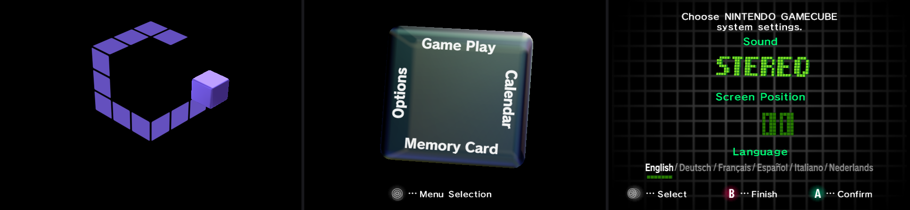

# GameCube IPL re-creation (Python)

A fan-made port of the GameCube boot animation and main menu to Python/OpenGL.
Logic is re-implemented from reverse engineering; models, textures, animations,
music and sound effects are read **at runtime from your own IPL (BIOS) dump**.



**This repository contains no Nintendo code or data.** You need to dump the IPL
from a GameCube you own. Not affiliated with or endorsed by Nintendo.
"Nintendo GameCube" is a trademark of Nintendo.

## Setup

1. Dump the IPL from your own console (PAL, Rev 1.0), e.g. with a homebrew IPL dumper.
2. Make it findable, any of:
   - put it at `IPL.bin` in this folder, or
   - put it where Dolphin expects it (`<Dolphin user dir>/GC/EUR/IPL.bin`), it is picked up automatically, or
   - set `GCIPL_IPL=/path/to/IPL.bin`.
3. Install and run:

```
python -m venv .venv
.venv/bin/pip install -r requirements.txt     # Windows: .venv\Scripts\pip
.venv/bin/python run.py                        # 60 Hz
.venv/bin/python run.py --pal50                # 50 Hz like a PAL console
```

The first start descrambles the dump (a few seconds) and caches the result in
`~/.cache/gcipl` (`%LOCALAPPDATA%\gcipl` on Windows).

Controls: **Enter / X** = A (hold during the intro to spin the cube), **Backspace / C** = B,
**Space / S** = START, arrows = stick, **R** = restart, **F11** = fullscreen, **Esc** = quit.
Hold **Z** while (re)starting for the hidden intro (Z+Shift = "all four pads" variant).
A connected gamepad works too.

## Layout

| path | what |
|---|---|
| `ipl/rom.py` | finds and descrambles the user's dump, reads BS2 constants and archive resources |
| `ipl/intro.py` | boot intro: rolling cube, trail grid, big cube physics, spin-up, zoom (BS2 0x8130c000..0x81310f58) |
| `ipl/bms.py` | JAudio BMS sequencer + sample synth (re-implementation of the IPL's sound engine) |
| `ipl/render.py`, `ipl/model.py`, `ipl/gx.py` | J3D model rendering with a GX/TEV material emulation |
| `ipl/anim.py` | BCK (joint) and IPK1 (material colour) animation |
| `ipl/menu_params.py` | menu tunables + the idle cube wobble |
| `ipl/menu/hub.py` | the main menu: cube rotation, panels on its faces, help bar |
| `ipl/menu/faces.py` | the little cubes inside the menu cube, one choreography per face |
| `ipl/menu/dotmatrix.py` | the cube dot-matrix displays (Calendar, Options, Game Play) |
| `ipl/menu/calendar.py`, `options.py`, `gameplay.py`, `memcard.py` | the four menus |
| `ipl/menu/block.py` | the menu tunables block (RAM 0x814b5ea0) |
| `ipl/gcmemcard.py` | Dolphin `.raw` memory card images: read, banners/icons, copy/move/erase/format |
| `tools/` | research tools: descrambler, Yay0, archive extractor, textures, models, BMS disassembler, Ghidra scripts |

Some research tools also want a Dolphin RAM dump (`mem1.raw`, taken while the IPL menu
is running); set `GCIPL_MEM1=/path/to/mem1.raw`. Their outputs are git-ignored.

## Status

- [x] Boot intro (all three jingles), logo animation, spin-up and zoom into the menu cube
- [x] Sound: real sequenced music and SFX (menu theme, jingles, cube whoosh)
- [x] Main menu: four faces, rotation, panels and help bar in all six PAL languages
- [x] Calendar: the cube dot-matrix date and time, editable (kept as an offset from the PC clock)
- [x] Options: Sound (mono/stereo), Screen Position (shifts the picture), Language
- [x] Game Play: "NO DISC" (there is no drive, so it is always the no-disc screen)
- [x] Memory Card: put Dolphin card images in `cards/` (`MemoryCardA*.raw`, `MemoryCardB*.raw`,
      or set `GCIPL_CARDS`); saves show as cubes with their icons and banners and can be moved,
      copied and erased (the first write makes a `.bak` of the image)

Settings (language, sound, screen position, clock adjustment) are saved in `settings.json`.

## License

MIT for the code here (see `LICENSE`). The IPL itself is Nintendo's and is not covered.
